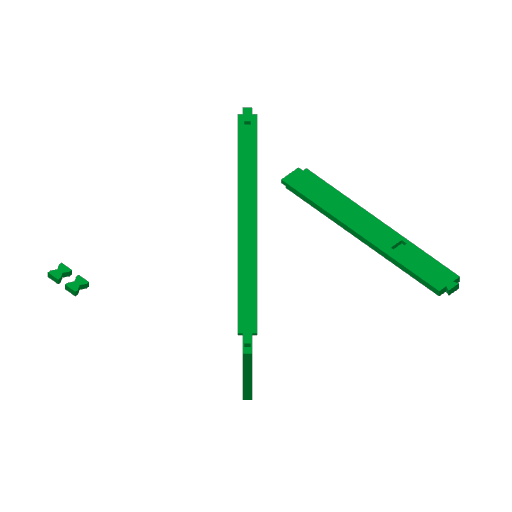
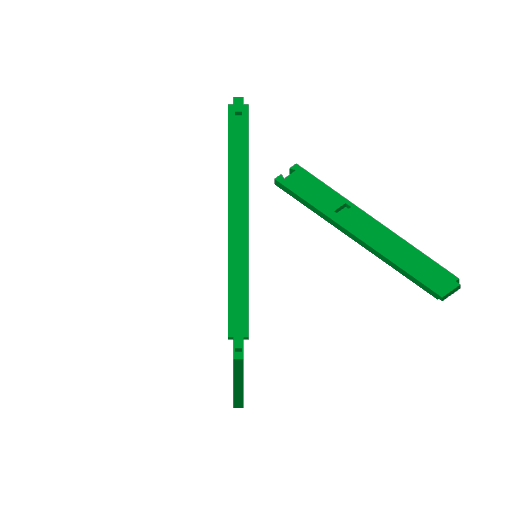
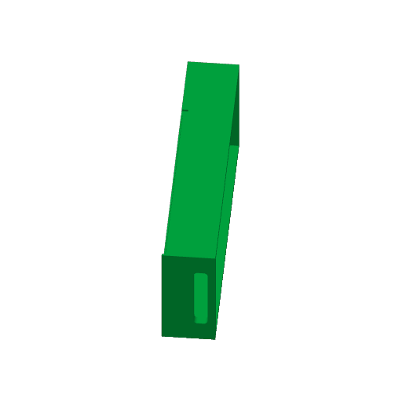
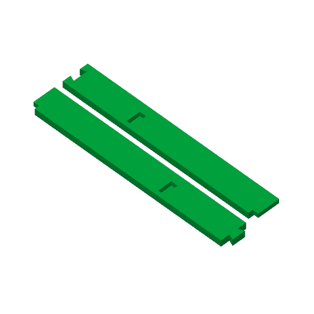

# ams2pro-ht/05-triple-drawer-layer

Status: **sliced_not_printed**

P2S · 0.4 mm · PETG Basic · Textured PEI · 0.20 mm

端框：普通 / Ends: plain

尚未实物试装、测试承重或上传 MakerWorld。 / Not physically validated or published to MakerWorld.

摆盘切片对比 / Sliced layout comparison:

| Metric | Before | After |
| --- | ---: | ---: |
| Plates | 13 | 10 |
| Estimated hours | 64.587 | 63.562 |
| PETG g | 1713.7 | 1737.36 |
| Support extrusion g | 299.16 | 280.11 |

支撑重量按 G-code 挤出量估算；未实物验证。 / Support mass is estimated from G-code extrusion; not physically validated.

[打开摆盘工程 / Open project](p2s-04-petg.3mf)

预计 / Estimate: 63.6 h · 1737.4 g PETG

| Plate | Parts | Preview |
| --- | --- | --- |
| 1 | 01 E01, E08, E12, E13 |  |
| 2 | 02 E02, E09 |  |
| 3 | 03 E03 |  |
| 4 | 04 E04 |  |
| 5 | 05 E05 |  |
| 6 | 06 E06 |  |
| 7 | 07 E07 |  |
| 8 | 08 E10, E11 |  |
| 9 | 09 E14 |  |
| 10 | 10 E15 |  |
