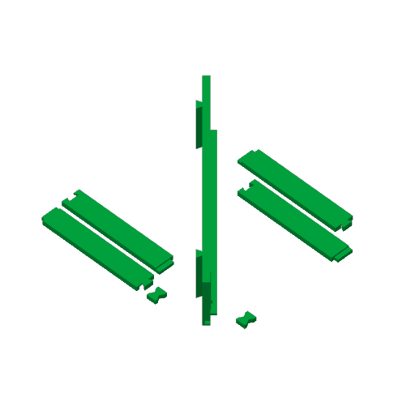
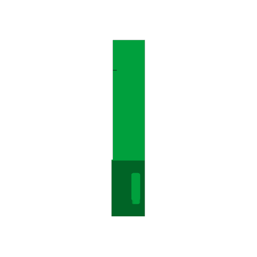

# ams2pro/2-drawer-layer

Status: **sliced_not_printed**

P2S · 0.4 mm · PETG Basic · Textured PEI · 0.20 mm

端框：普通 / Ends: plain

尚未实物试装、测试承重或上传 MakerWorld。 / Not physically validated or published to MakerWorld.

摆盘切片对比 / Sliced layout comparison:

| Metric | Before | After |
| --- | ---: | ---: |
| Plates | 8 | 7 |
| Estimated hours | 51.229 | 49.618 |
| PETG g | 1372.99 | 1392.95 |
| Support extrusion g | 238.765 | 215.135 |

支撑重量按 G-code 挤出量估算；未实物验证。 / Support mass is estimated from G-code extrusion; not physically validated.

[打开摆盘工程 / Open project](p2s-04-petg.3mf)

预计 / Estimate: 49.6 h · 1393.0 g PETG

| Plate | Parts | Preview |
| --- | --- | --- |
| 1 | 01 ND01 |  |
| 2 | 02 ND02 |  |
| 3 | 03 ND03, ND06, ND07, ND08, ND09, ND12, ND13 |  |
| 4 | 04 ND04 |  |
| 5 | 05 ND05 |  |
| 6 | 06 ND10 |  |
| 7 | 07 ND11 |  |
