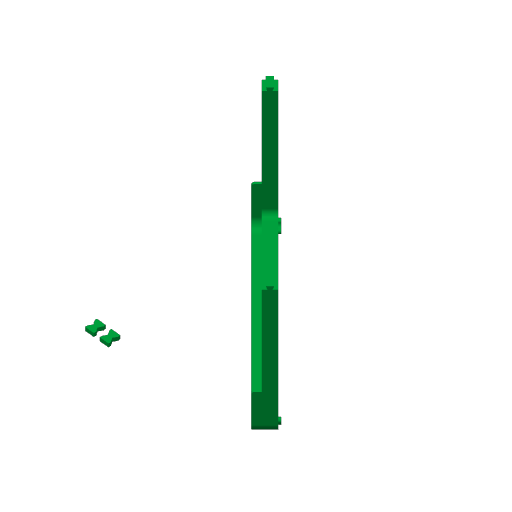
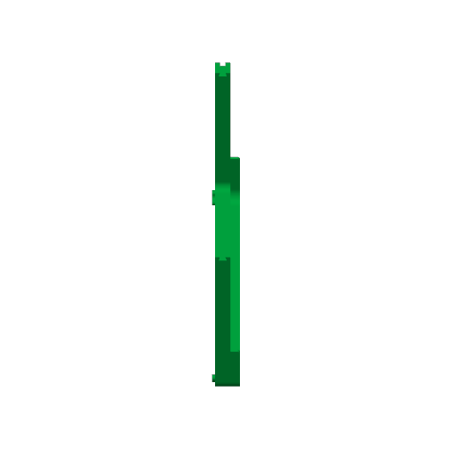

# ams2pro/device-top

Status: **sliced_not_printed**

P2S · 0.4 mm · PETG Basic · Textured PEI · 0.20 mm

端框：普通 / Ends: plain

尚未实物试装、测试承重或上传 MakerWorld。 / Not physically validated or published to MakerWorld.

摆盘切片对比 / Sliced layout comparison:

| Metric | Before | After |
| --- | ---: | ---: |
| Plates | 3 | 2 |
| Estimated hours | 11.472 | 11.422 |
| PETG g | 269.33 | 269.24 |
| Support extrusion g | 1.625 | 1.624 |

支撑重量按 G-code 挤出量估算；未实物验证。 / Support mass is estimated from G-code extrusion; not physically validated.

[打开摆盘工程 / Open project](p2s-04-petg.3mf)

预计 / Estimate: 11.4 h · 269.2 g PETG

| Plate | Parts | Preview |
| --- | --- | --- |
| 1 | 01 NE01, NE03, NE04 |  |
| 2 | 02 NE02 |  |
