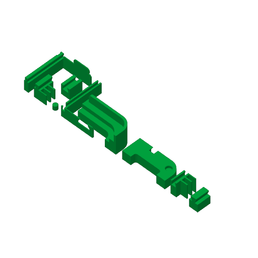

# fit-check/256-joints

Status: **sliced_not_printed**

P2S · 0.4 mm · PETG Basic · Textured PEI · 0.20 mm

试配小件 / Fit specimens

尚未实物试装、测试承重或上传 MakerWorld。 / Not physically validated or published to MakerWorld.

[PETG Matte · 打开工程 / Open project](p2s-04-petg-matte.3mf)

Matte · 1 盘 / plates · 1.46 h · 45.27 g · 支撑 / support 0.00 g

[打开摆盘工程 / Open project](p2s-04-petg.3mf)

预计 / Estimate: 1.4 h · 41.3 g PETG

| Plate | Parts | Preview |
| --- | --- | --- |
| 1 | 01 Wa, Wb, HT02, HT01, Ra, Rb, Sa, Sb, HT04 |  |
