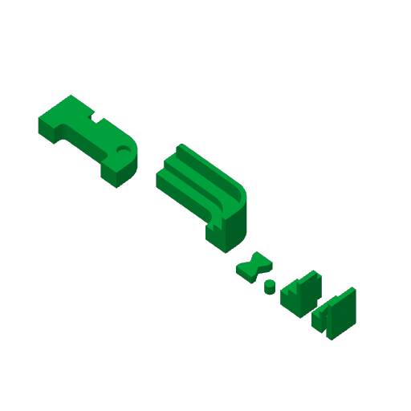

# fit-check/ht-top

Status: **sliced_not_printed**

P2S · 0.4 mm · PETG Basic · Textured PEI · 0.20 mm

试配小件 / Fit specimens

尚未实物试装、测试承重或上传 MakerWorld。 / Not physically validated or published to MakerWorld.

旧 F02 的 PETG Matte 实打遇到支撑难拆，层间定位脚和圆角有缝。请选择与耗材匹配的工程或预设。

The original matte PETG print had stuck supports and gaps at the stacking foot and corners. Choose the project or filament preset for your spool.

[PETG Matte · 打开工程 / Open project](p2s-04-petg-matte.3mf)

Matte · 1 盘 / plates · 1.10 h · 31.37 g · 支撑 / support 0.00 g

每道接缝左右各用一片，所有层通用。 / Use two identical bowties per seam, one on each side. [通用尾锁 / Rear key STL](../../../../models/common/rear-lock.stl)

把 HT04 圆销放入下层 HT01，再放上 HT02，从后方水平推入通用蝴蝶锁片 HT03。检查锁槽顶面、外圆角及能否徒手退出。HT05 与 HT06 竖直合拢，检查新接缝。

Place HT04 in the lower HT01 hole, then lower HT02 onto it and slide the common HT03 bowtie in from the rear, either end up. Inspect the pocket roof and round corner, then withdraw the key by hand. Lower HT05 into HT06 to test the rail joint.

[打开摆盘工程 / Open project](p2s-04-petg.3mf)

预计 / Estimate: 1.1 h · 28.6 g PETG

| Plate | Parts | Preview |
| --- | --- | --- |
| 1 | 01 HT01, HT02, HT03, HT04, HT05, HT06 |  |
