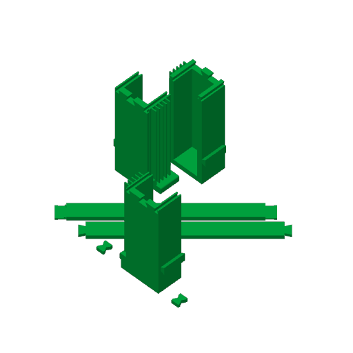
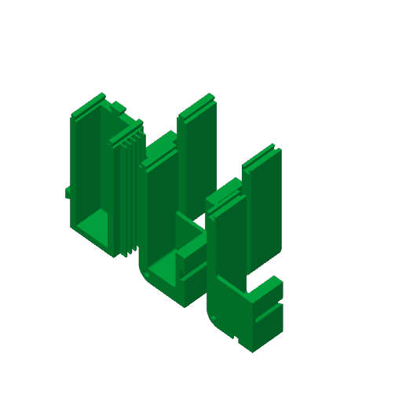

# ams2pro-ht/01-five-slot-plate-layer

Status: **sliced_not_printed**

X2D · 0.4 mm · PETG Basic · Textured PEI · 0.20 mm

普通端框 / Plain ends

尚未实物试装、测试承重或上传 MakerWorld。 / Not physically validated or published to MakerWorld.

[PETG Matte · 打开工程 / Open project](x2d-04-petg-matte.3mf)

Matte · 2 盘 / plates · 25.71 h · 877.16 g · 支撑 / support 16.36 g

同编号的 a 和 b 竖直合拢。J 是整根横梁。 / Lower matching a/b sections together. J denotes a one-piece beam.

每道接缝左右各用一片，所有层通用。 / Use two identical bowties per seam, one on each side. [通用尾锁 / Rear key STL](../../../../models/common/rear-lock.stl)

摆盘切片对比 / Sliced layout comparison:

| Metric | Before | After |
| --- | ---: | ---: |
| Plates | 5 | 2 |
| Estimated hours | 33.311 | 24.431 |
| PETG g | 832.51 | 800.33 |
| Support extrusion g | 117.336 | 14.931 |

支撑重量按 G-code 挤出量估算；未实物验证。 / Support mass is estimated from G-code extrusion; not physically validated.

[打开摆盘工程 / Open project](x2d-04-petg.3mf)

预计 / Estimate: 24.4 h · 800.3 g PETG

| Plate | Parts | Preview |
| --- | --- | --- |
| 1 | 01 A03, A04, A02b, A01b, A02a, KEY-left, KEY-right |  |
| 2 | 02 A01a, A05a, A05b, A06a, A06b |  |
