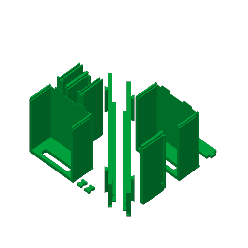
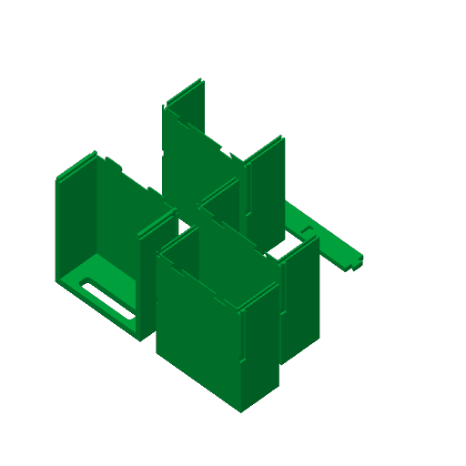
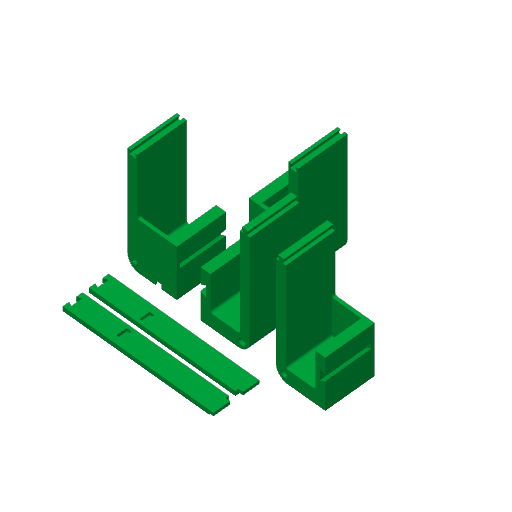

# ams2pro-ht/05-triple-drawer-layer

Status: **sliced_not_printed**

X2D · 0.4 mm · PETG Basic · Textured PEI · 0.20 mm

普通端框 / Plain ends

尚未实物试装、测试承重或上传 MakerWorld。 / Not physically validated or published to MakerWorld.

[PETG Matte · 打开工程 / Open project](x2d-04-petg-matte.3mf)

Matte · 3 盘 / plates · 47.65 h · 1744.48 g · 支撑 / support 19.46 g

同编号的 a 和 b 竖直合拢。J 是整根横梁。 / Lower matching a/b sections together. J denotes a one-piece beam.

每道接缝左右各用一片，所有层通用。 / Use two identical bowties per seam, one on each side. [通用尾锁 / Rear key STL](../../../../models/common/rear-lock.stl)

摆盘切片对比 / Sliced layout comparison:

| Metric | Before | After |
| --- | ---: | ---: |
| Plates | 10 | 3 |
| Estimated hours | 63.442 | 44.841 |
| PETG g | 1737.36 | 1591.68 |
| Support extrusion g | 280.11 | 17.759 |

支撑重量按 G-code 挤出量估算；未实物验证。 / Support mass is estimated from G-code extrusion; not physically validated.

[打开摆盘工程 / Open project](x2d-04-petg.3mf)

预计 / Estimate: 44.8 h · 1591.7 g PETG

| Plate | Parts | Preview |
| --- | --- | --- |
| 1 | 01 E14, E15, E03a, E04a, E08, E01a, E01b, E02a, E02b, E12, E13 |  |
| 2 | 02 E05a, E03b, E04b, E05b, E10 |  |
| 3 | 03 E09, E11, E06a, E06b, E07a, E07b |  |
