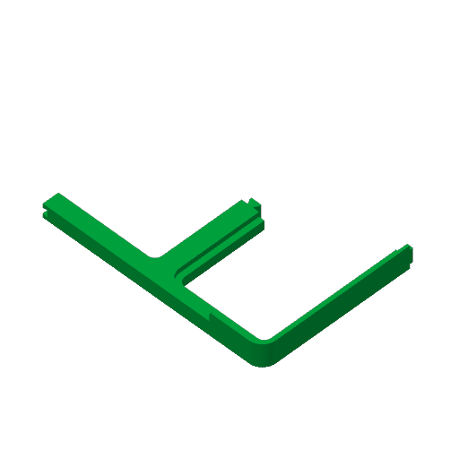

# ams2pro-ht/06-device-top

Status: **sliced_not_printed**

X2D · 0.4 mm · PETG Basic · Textured PEI · 0.20 mm

端框：普通 / Ends: plain

尚未实物试装、测试承重或上传 MakerWorld。 / Not physically validated or published to MakerWorld.

摆盘切片对比 / Sliced layout comparison:

| Metric | Before | After |
| --- | ---: | ---: |
| Plates | 3 | 2 |
| Estimated hours | 15.272 | 15.222 |
| PETG g | 332.76 | 332.67 |
| Support extrusion g | 35.354 | 35.353 |

支撑重量按 G-code 挤出量估算；未实物验证。 / Support mass is estimated from G-code extrusion; not physically validated.

[打开摆盘工程 / Open project](x2d-04-petg.3mf)

预计 / Estimate: 15.2 h · 332.7 g PETG

| Plate | Parts | Preview |
| --- | --- | --- |
| 1 | 01 F01, F03, F04 |  |
| 2 | 02 F02 |  |
