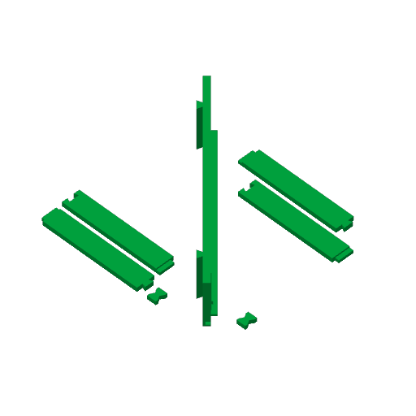
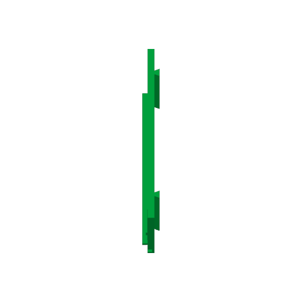
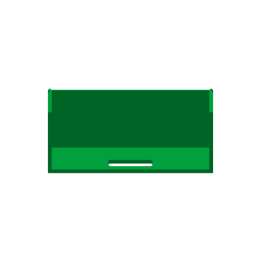
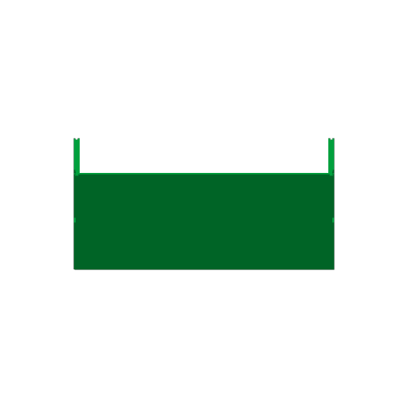

# ams2pro/1-drawer-layer

Status: **sliced_not_printed**

X2D · 0.4 mm · PETG Basic · Textured PEI · 0.20 mm

端框：普通 / Ends: plain

尚未实物试装、测试承重或上传 MakerWorld。 / Not physically validated or published to MakerWorld.

摆盘切片对比 / Sliced layout comparison:

| Metric | Before | After |
| --- | ---: | ---: |
| Plates | 8 | 6 |
| Estimated hours | 32.562 | 31.375 |
| PETG g | 1037.74 | 1057.52 |
| Support extrusion g | 53.331 | 30.251 |

支撑重量按 G-code 挤出量估算；未实物验证。 / Support mass is estimated from G-code extrusion; not physically validated.

[打开摆盘工程 / Open project](x2d-04-petg.3mf)

预计 / Estimate: 31.4 h · 1057.5 g PETG

| Plate | Parts | Preview |
| --- | --- | --- |
| 1 | 01 NC01 |  |
| 2 | 02 NC02 |  |
| 3 | 03 NC03, NC05, NC06, NC07, NC08, NC11, NC12 |  |
| 4 | 04 NC04 |  |
| 5 | 05 NC09 |  |
| 6 | 06 NC10 |  |
