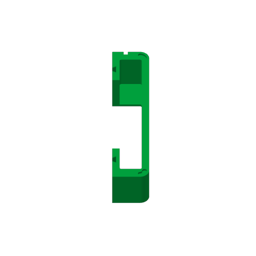
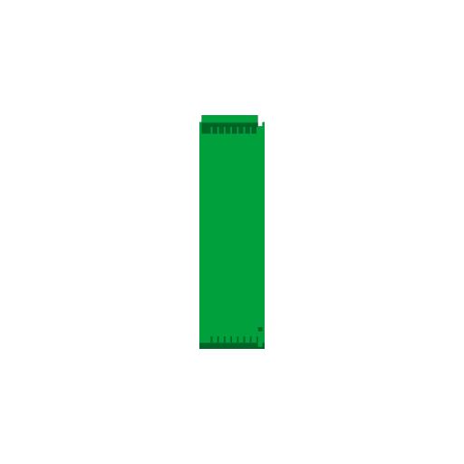
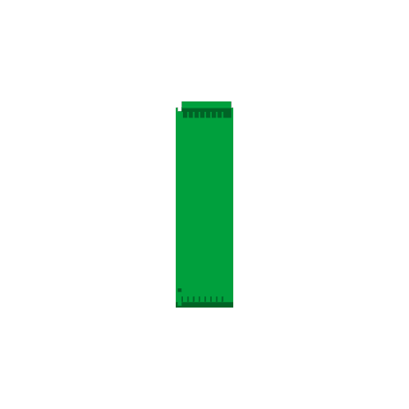
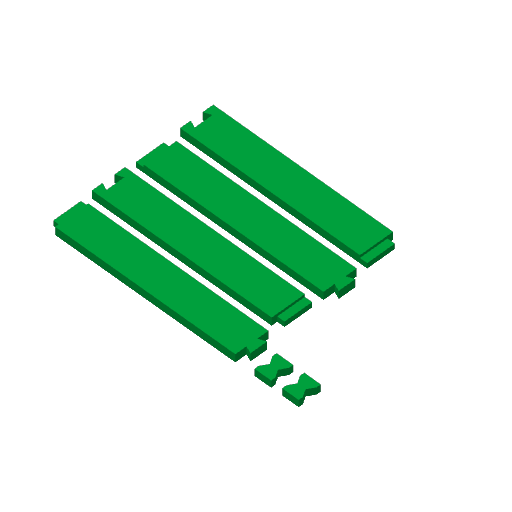

# ams2pro/8-slot-plate-layer

Status: **sliced_not_printed**

X2D · 0.4 mm · PETG Basic · Textured PEI · 0.20 mm

端框：普通 / Ends: plain

尚未实物试装、测试承重或上传 MakerWorld。 / Not physically validated or published to MakerWorld.

摆盘切片对比 / Sliced layout comparison:

| Metric | Before | After |
| --- | ---: | ---: |
| Plates | 6 | 5 |
| Estimated hours | 29.382 | 29.1 |
| PETG g | 723.03 | 755.32 |
| Support extrusion g | 90.248 | 79.524 |

支撑重量按 G-code 挤出量估算；未实物验证。 / Support mass is estimated from G-code extrusion; not physically validated.

[打开摆盘工程 / Open project](x2d-04-petg.3mf)

预计 / Estimate: 29.1 h · 755.3 g PETG

| Plate | Parts | Preview |
| --- | --- | --- |
| 1 | 01 NB01 |  |
| 2 | 02 NB02 |  |
| 3 | 03 NB03 |  |
| 4 | 04 NB04 |  |
| 5 | 05 NB05, NB06, NB07, NB08, NB09, NB10 |  |
