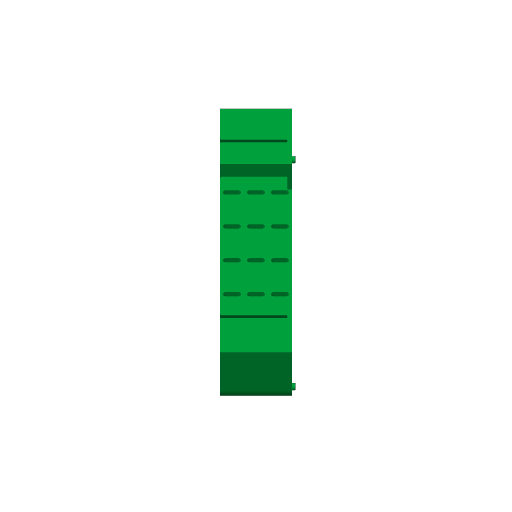
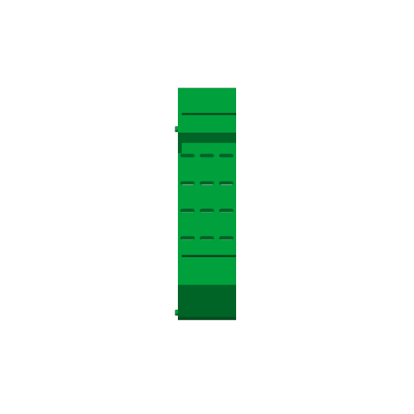

# common/pegboard-60

Status: **sliced_not_printed**

X2D · 0.4 mm · PETG Basic · Textured PEI · 0.20 mm

洞洞板端框 / Pegboard ends

尚未实物试装、测试承重或上传 MakerWorld。 / Not physically validated or published to MakerWorld.

[PETG Matte · 打开工程 / Open project](x2d-04-petg-matte.3mf)

Matte · 2 盘 / plates · 14.15 h · 364.32 g · 支撑 / support 45.60 g

每道接缝左右各用一片，所有层通用。 / Use two identical bowties per seam, one on each side. [通用尾锁 / Rear key STL](../../../../models/common/rear-lock.stl)

[打开摆盘工程 / Open project](x2d-04-petg.3mf)

预计 / Estimate: 13.5 h · 332.4 g PETG

| Plate | Parts | Preview |
| --- | --- | --- |
| 1 | 01 G60L |  |
| 2 | 02 G60R |  |
