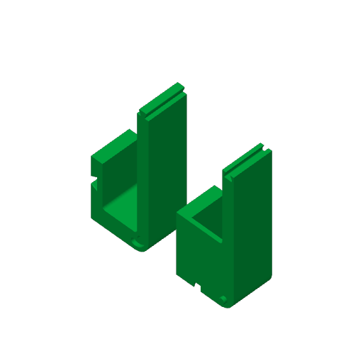

# compatibility/ht-right-40

Status: **sliced_not_printed**

X2D · 0.4 mm · PETG Basic · Textured PEI · 0.20 mm

旧 HT 顶件过渡端框 / Legacy HT-top end

尚未实物试装、测试承重或上传 MakerWorld。 / Not physically validated or published to MakerWorld.

[PETG Matte · 打开工程 / Open project](x2d-04-petg-matte.3mf)

Matte · 1 盘 / plates · 5.36 h · 165.36 g · 支撑 / support 3.18 g

这对前后段合成一只右端框，用于上方保留旧弧脚、下方连接新版圆孔。 / Join the two sections into one right end for an older curved upper foot on a new round-pin stack.

每道接缝左右各用一片，所有层通用。 / Use two identical bowties per seam, one on each side. [通用尾锁 / Rear key STL](../../../../models/common/rear-lock.stl)

[打开摆盘工程 / Open project](x2d-04-petg.3mf)

预计 / Estimate: 5.2 h · 150.9 g PETG

| Plate | Parts | Preview |
| --- | --- | --- |
| 1 | 01 L40Ra, L40Rb |  |
