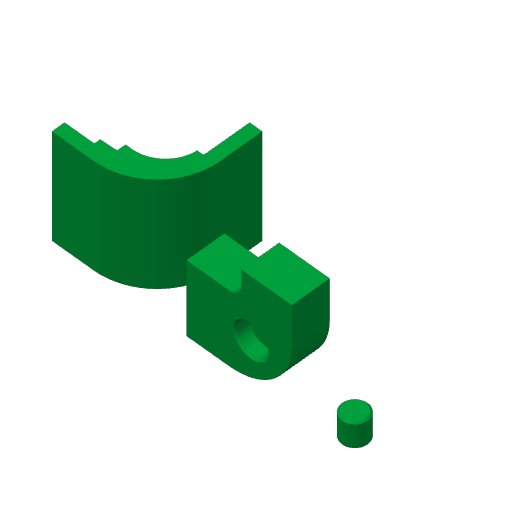

# fit-check/front-pin

Status: **sliced_not_printed**

X2D · 0.4 mm · PETG Basic · Textured PEI · 0.20 mm

试配小件 / Fit specimens

尚未实物试装、测试承重或上传 MakerWorld。 / Not physically validated or published to MakerWorld.

[PETG Matte · 打开工程 / Open project](x2d-04-petg-matte.3mf)

Matte · 1 盘 / plates · 0.56 h · 10.98 g · 支撑 / support 0.05 g

把短圆销 P3 放入下层 P1，再落下顶件前角 P2。翻转圆销再试一次。 / Put P3 into P1, lower P2 and repeat with the pin flipped.

[打开摆盘工程 / Open project](x2d-04-petg.3mf)

预计 / Estimate: 0.6 h · 10.0 g PETG

| Plate | Parts | Preview |
| --- | --- | --- |
| 1 | 01 P2, P1, P3 |  |
